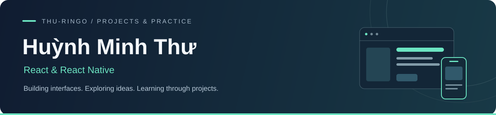

  

  <b>Web interfaces · Mobile applications · Learning by building</b> 
  Industrial University of Ho Chi Minh City · Vietnam

  <a href="#selected-projects">Selected projects</a> &nbsp;·&nbsp;
  <a href="#technologies">Technologies</a> &nbsp;·&nbsp;
  <a href="#coursework">Coursework</a>

---

### Hello, I'm Thư

I'm exploring frontend development through React and React Native projects. My repositories include web interfaces, a mobile health-tracking app, a Java backend, and a Unity game.

This profile highlights selected projects first, with weekly exercises collected separately for anyone interested in my learning progress.

### Selected projects

#### 01 / Ginkgo · Personal health tracking

A mobile course project for recording health metrics, viewing trends, and scheduling medication reminders.

**React Native · Expo · TypeScript · NestJS · MariaDB**

- Health journals, charts, and local medication notifications.
- Account authentication and realtime update notifications through Socket.IO.
- Repository includes setup instructions, API documentation, and test suites.

[Explore the project →](https://github.com/thu-ringo/GinkgoHealthyApp) &nbsp; [Setup guide](https://github.com/thu-ringo/GinkgoHealthyApp/blob/main/HUONG_DAN_CHAY.md)

#### 02 / Movie Explorer · Movie discovery interface

A React web project for browsing trending and top-rated movies, searching titles, and opening trailers.

**React · JavaScript · Tailwind CSS · Vite · TMDB API**

- Movie lists and keyword search using API data.
- Shared trailer state with React Context and a video modal.

[Explore the project →](https://github.com/thu-ringo/movie)

#### 03 / Restaurant Management · Java backend

A backend course project for restaurant records and table reservations, with JSON requests and responses over TCP sockets.

**Java · Spring Boot · Spring Data JPA · MariaDB · Maven**

- Services and repositories for tables, customers, dishes, and reservations.
- Reservation creation and cancellation with table-status updates.

[Explore the project →](https://github.com/thu-ringo/QuanLyNhaHang_JavaPT) &nbsp; [Technical README](https://github.com/thu-ringo/QuanLyNhaHang_JavaPT/blob/main/nhahang-server/README.md)

<b>Also exploring: Rune Bastion · Unity game development</b>

A 2D defense game featuring elemental spells, enemy waves, upgrades, and a boss encounter.

**Unity · C#**

[Explore Rune Bastion →](https://github.com/thu-ringo/GameRuneBastion)

### Technologies

Technologies used across the projects and exercises in my repositories:

| Area | Technologies |
| :--- | :--- |
| Web | JavaScript, React, Tailwind CSS, Vite |
| Mobile | TypeScript, React Native, Expo |
| Backend & data | NestJS, Java, Spring Boot, MariaDB |
| Other explorations | C#, Unity |

### Coursework

Weekly exercises cover React fundamentals, mobile development, and software architecture. They are grouped in a separate index to keep the featured work easy to browse.

[Browse the coursework index →](./LEARNING.md)
